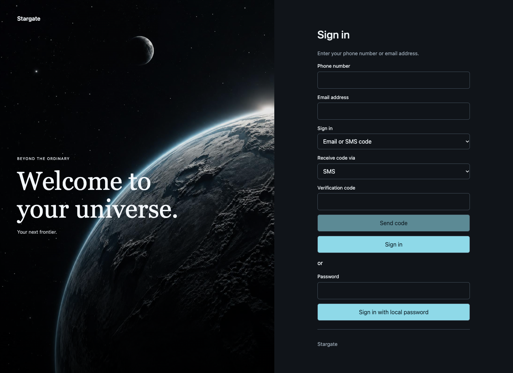

# Stargate themes

Native authentication themes for [Stargate](https://github.com/soulteary/stargate).
Themes contain a YAML manifest and optional images. Stargate renders the forms,
handles authentication and supplies the layout styles. No JavaScript, HTML,
external fonts or frontend runtime is included in a theme.

## Deep Space

A fixed dark palette with a planetary background, a serif brand heading and a
two-column desktop layout. Below 900px the brand panel sits above the form. The
same appearance applies to password and verification-code login, account
settings, TOTP setup and removal, and additional verification. Authentication
labels follow Stargate's language setting; decorative brand copy is English.
Reduced-motion preferences disable the background and entry animations.



[Mobile preview](previews/deep-space/mobile.png)

## Install

This theme requires [native theme support](https://github.com/soulteary/stargate/pull/387).
CI uses Stargate commit `4a86331857b3b0d52bf061d5a7cd2d37faba292a`.
It does not work with builds that only support external template overrides.
Both the manifest and UI contract are version `1`.

Copy `themes/deep-space` onto the server, or extract a packaged archive into a
directory. Set the path to that directory:

```sh
THEME_DIR=/path/to/deep-space /path/to/stargate
```

For Docker, add to the existing Stargate service:

```yaml
services:
  stargate:
    environment:
      THEME_DIR: /app/themes/deep-space
    volumes:
      - ./themes/deep-space:/app/themes/deep-space:ro
```

The runtime user (UID 10001 in the official image) needs read access to files
and traversal access to directories. Restart Stargate after changes. An invalid
selected theme prevents startup. Set `THEME_SAFE_MODE=true` and restart to use
the built-in interface, ignoring themes and legacy resource overrides.

Site title, footer and support link remain controlled by `LOGIN_PAGE_TITLE`,
`LOGIN_PAGE_FOOTER_TEXT` and `LOGIN_SUPPORT_URL`. Colors and decorative copy can
be changed in `theme.yml`; no application build is needed.

The server makes no requests to this repository and does not install or update
themes automatically. It reads an extracted directory, not a ZIP file. Install
the same theme on every replica. Old pages may need reloading after an update,
since each process serves only its current resource digest.

## Validate and package

Use a checkout of Stargate containing native theme support:

```sh
go -C ../stargate run ./src/cmd/themecheck "$PWD/themes/deep-space"
python3 tools/package.py --stargate ../stargate
```

The packager first runs Stargate's validator, then writes `dist/deep-space-1.0.0.zip`
and `dist/index.json`. The index includes package size, SHA-256, theme version,
contract versions and the runtime resource digest. Archives have sorted entries,
fixed timestamps and file permissions. Identical sources produce identical
archives with the same Python/zlib toolchain.

Compare the SHA-256 of a downloaded archive with its published index before
extracting it. Packages contain `theme.yml`, the declared image and `LICENSE.txt`.
Screenshots and repository tools are not installed on the server.

See [CONTRIBUTING.md](CONTRIBUTING.md) for changes and verification.

## License

The repository and Deep Space theme are distributed under Apache-2.0.
The theme includes its license in `LICENSE.txt`. No remote font is required.
